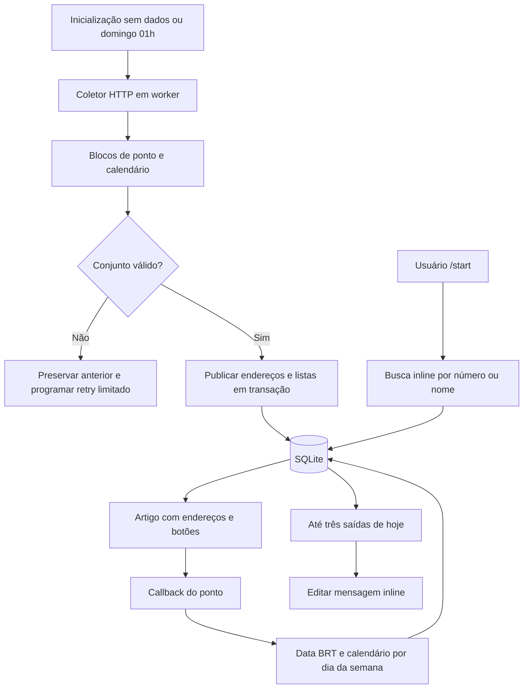

# Phase 1: Primeiras consultas no Telegram - Research

**Researched:** 2026-11-13
**Domain:** Coleta de horários, SQLite e consulta inline no Telegram
**Confidence:** MEDIUM

<user_constraints>
## User Constraints (from CONTEXT.md)

As decisões abaixo são transcrição do contexto aprovado, não novas inferências. Fonte: `.planning/phases/01-primeiras-consultas-no-telegram/01-CONTEXT.md`, aberto nesta pesquisa.

### Escolha da linha
- **D-01:** Buscar por número ou parte do nome, mostrando sugestões no formato `123 - Papicu/Rua Doidinho da Silva`.
- **D-02:** Usar sugestões inline do Telegram enquanto o usuário digita `@NomeDoBot 12` ou `@NomeDoBot papicu`, em vez de exigir o envio de cada termo como mensagem na conversa.
- **D-03:** Ao selecionar a sugestão, mostrar diretamente os endereços daquela linha; escolher o endereço consulta os próximos horários, sem uma etapa intermediária de resumo.
- **D-04:** Ignorar acentos e diferenças entre maiúsculas e minúsculas: `joao` encontra `São João`.
- **D-05:** Apresentar dez resultados por página e carregar mais ao rolar.

### Atualização dos dados
- **D-06:** Coletar todo domingo às 01h no fuso `America/Sao_Paulo`.
- **D-07:** Se uma linha falhar, manter seus últimos dados válidos e tentar novamente mais tarde.
- **D-08:** Após uma coleta válida, substituir o conjunto antigo pelo novo, removendo horários que desapareceram da origem; não apenas acumular horários.
- **D-09:** Rejeitar a atualização de uma linha quando a primeira ou segunda coleção obrigatória estiver vazia; preservar os últimos dados válidos e continuar as demais linhas.
- **D-10:** Fazer coleta inicial automática quando ainda não houver horários no banco; depois seguir a atualização semanal.

### Decisões anteriores preservadas
- **D-11:** Manter as duas tabelas solicitadas, com até cinco endereços e cinco coleções independentes de horários separadas por calendário, relacionadas por chave estrangeira. As duas primeiras coleções são obrigatórias.
- **D-12:** Não parear horários de pontos diferentes pelo índice. Preservar listas com tamanhos diferentes e descartar publicidade presente entre os itens de horários.
- **D-13:** Retornar somente as saídas de hoje disponíveis, até três, em ordem; mostrar uma ou duas se não houver três, sem completar com amanhã.

### Detalhes a resolver na pesquisa e no planejamento
Não houve delegação explícita de preferências adicionais. Identidade das tabelas, serialização das coleções, estratégia de retry e seus limites são detalhes técnicos a propor respeitando as decisões acima.

Validar como a seleção inline exibe os endereços e consulta o ponto dentro do Telegram, incluindo o uso em conversa privada iniciada por `/start`, callback e identificadores estáveis. Não presumir que todo resultado inline produza uma atualização de seleção recebida pelo bot; documentar a configuração necessária. Não substituir a experiência inline aprovada por busca via mensagem sem revisão.

### Deferred Ideas (OUT OF SCOPE)
Nenhuma nova capacidade fora de escopo foi solicitada. Feriados, navegação completa, amanhã e alertas continuam nas fases 2 a 5 conforme o roadmap.
</user_constraints>

## Project Constraints (from AGENTS.md)

Diretivas aplicáveis, lidas em `AGENTS.md`: preservar o coletor Python e catálogo SQLite; primeiras duas coleções obrigatórias e FK aplicada; Brasília; dados das páginas do catálogo; interface portuguesa começando pela linha; funções snake_case, constantes em maiúsculas, tipos/dataclasses imutáveis; quatro espaços e aspas duplas; SQL parametrizado com colunas explícitas e conexões por contexto; helpers retornam dados e apresentação fica nas fronteiras; imports sem efeitos graças a `__main__`; não usar arquivo temporário do editor como padrão; mudanças devem ocorrer dentro do fluxo GSD. A presente pesquisa integra `/gsd-plan-phase`. [VERIFIED: AGENTS.md:13-17,83-139,257-267]

## Summary

Recomendação de engenharia: criar um monólito modular pequeno, preservando as entradas atuais. O caminho inicial deve provar HTML real → parser → duas tabelas → busca inline → endereço → próximas saídas. A coleta completa e seu agendamento ampliam esse mesmo caminho depois. Não organizar os planos somente por banco, parser e bot isolados.

O autocomplete aprovado é implementável sem aguardar uma notificação de resultado escolhido: o artigo inline já carrega o texto com os endereços e um teclado de pontos. Ao tocar no ponto, um callback edita a mensagem inline. `ChosenInlineResult` depende de feedback habilitado e não deve conduzir o fluxo essencial. [CITED: https://docs.python-telegram-bot.org/en/stable/telegram.inlinequeryresultarticle.html] [CITED: https://docs.python-telegram-bot.org/en/stable/telegram.callbackquery.html] [CITED: https://docs.python-telegram-bot.org/en/stable/telegram.choseninlineresult.html]

A estrutura ampla aprovada exige listas independentes; uma coleção por ponto e calendário evita inventar relações de viagens. O catálogo existente precisa ser preservado. No código atual, a definição literal é `CREATE TABLE IF NOT EXISTS linhas (` com `numero INTEGER PRIMARY KEY`, `nome TEXT NOT NULL`, `link TEXT NOT NULL`, `created_at TEXT NOT NULL`; a escrita usa `INSERT OR IGNORE INTO linhas (numero, nome, link, created_at)`. [VERIFIED: scraping.py:86-112] Não reutilizar esse insert-only como se atualizasse os novos horários.

## Architectural Responsibility Map

| Capability | Primary Tier | Secondary Tier | Rationale |
|------------|--------------|----------------|-----------|
| Sugestões e seleção | Cliente Telegram | Adaptador backend | O cliente renderiza resultados; backend responde com artigos e teclado. [CITED: https://core.telegram.org/bots/inline] |
| Correspondência de ponto/calendário | Backend parser | Repositório | Proposta: interpretar e validar antes da publicação. |
| Publicação íntegra | Database / Storage | Serviço de coleta | Proposta: substituir a linha em uma transação curta. |
| Próximas saídas | Backend domínio | Banco | Proposta: comparar instantes com relógio injetado, sem scraping no handler. |
| Domingo e retries | Backend scheduler | Worker de coleta | Proposta: um dono do agendamento; requests fora do loop assíncrono. |

## Standard Stack

Versões consultadas no PyPI com `pip index versions`, sem instalação. A documentação oficial PTB identifica a versão estável correspondente; os nomes abaixo têm auditoria SUS por métricas incompletas e **não** recebem selo VERIFIED de legitimidade. [CITED: https://docs.python-telegram-bot.org/en/stable/] [CITED: https://pypi.org/project/python-telegram-bot/22.8/]

| Biblioteca | Versão candidata | Uso e evidência |
|------------|------------------|----------------|
| Python | Ambiente observado 3.11.9 | Manter por compatibilidade inicial; requisito declarado PTB é `Python >=3.10`. [VERIFIED: probe python --version] [CITED: https://pypi.org/project/python-telegram-bot/22.8/] |
| `python-telegram-bot` [WARNING: auditoria SUS; verificar antes de instalar] | 22.8, publicada 2026-06-12 | Handlers async, resultados inline e JobQueue; instalar extra `job-queue`. [CITED: https://pypi.org/project/python-telegram-bot/22.8/] |
| `tzdata` [WARNING: auditoria SUS; verificar antes de instalar] | 2026.6, publicada 2026-10-28 | Dados IANA de fallback no Windows; primeiro projeto mantido por Python. [CITED: https://pypi.org/project/tzdata/2026.6/] [CITED: https://docs.python.org/3.11/library/zoneinfo.html] |
| `requests` | 2.34.2 instalada e disponível no índice | Preservar dependência existente; a importação literal atual é `import requests`. [VERIFIED: pip index versions requests; scraping.py:10-11] |
| `beautifulsoup4` | 4.15.0 instalada e disponível no índice | Preservar dependência existente; importação literal `from bs4 import BeautifulSoup`. [VERIFIED: pip index versions beautifulsoup4; scraping.py:10-11] |
| `sqlite3`, `zoneinfo`, `unittest` | Biblioteca padrão Python | Banco, fuso e testes sem pacote de testes adicional. [CITED: https://docs.python.org/3.11/library/sqlite3.html] [CITED: https://docs.python.org/3.11/library/zoneinfo.html] [CITED: https://docs.python.org/3/library/unittest.html] |

Instalação proposta, somente na execução e após resolver a auditoria dos pacotes novos:

```powershell
.venv/Scripts/python.exe -m pip install "python-telegram-bot[job-queue]==22.8" "tzdata==2026.6"
```

Não adicionar APScheduler de versão arbitrária: o extra JobQueue deve resolver a versão compatível. Não adicionar ORM, servidor HTTP ou framework de busca para esta entrega. São recomendações de engenharia, não novas decisões do usuário.

## Package Legitimacy Audit

Executado `query package-legitimacy check --ecosystem pypi python-telegram-bot tzdata requests beautifulsoup4`. A primeira execução no sandbox não conseguiu obter metadados; a repetição autorizada retornou existência e links oficiais. Todas receberam SUS porque o seam não obteve downloads semanais; tzdata também foi marcado too-new pela data da versão. **Métrica desconhecida não comprova pacote inseguro.** [VERIFIED: saída do seam em 2026-11-13]

| Package | Registry | Data observada | Downloads | Source Repo / projeto | Verdict | Disposition |
|---------|----------|----------------|-----------|-----------------------|---------|-------------|
| python-telegram-bot | PyPI | 2026-06-12 | Não fornecido pelo seam | Projeto oficial python-telegram-bot.org, PyPI aponta seu GitHub | SUS: unknown-downloads | Novo; checkpoint de verificação antes da instalação conforme contrato da persona |
| tzdata | PyPI | 2026-10-28 | Não fornecido pelo seam | github.com/python/tzdata | SUS: too-new, unknown-downloads | Novo; checkpoint de verificação antes da instalação conforme contrato da persona |
| requests | PyPI | 2026-05-14 | Não fornecido pelo seam | github.com/psf/requests | SUS: unknown-downloads | Já instalado; preservar, não impor reinstalação nem gate novo por usá-lo |
| beautifulsoup4 | PyPI | 2026-06-07 | Não fornecido pelo seam | crummy.com/software/BeautifulSoup/bs4 | SUS: unknown-downloads | Já instalado; preservar, não impor reinstalação nem gate novo por usá-lo |

As datas são de versão retornada, não idade comprovada do projeto. Não houve SLOP nem remoção. A verificação dos pacotes novos pode ser um checkpoint conjunto na execução com os links oficiais acima, evitando perguntas durante a criação de planos. Não inferir aprovação de instalação desta pesquisa.

## Architecture Patterns

### System Architecture Diagram



Diagrama é proposta; capacidades de artigos e callbacks sustentadas pelas referências PTB citadas no resumo.

### Recommended Project Structure

Proposta de caminhos **novos**, não arquivos existentes: `bot.py` como entrada; pacote `onibus/` com `config.py`, `models.py`, `storage.py`, `scraping.py`, `schedules.py`, `telegram_handlers.py` e `refresh.py`; testes em `tests/`. O planner pode reduzir módulos se mantiver fronteiras claras. Os nomes novos não são alegações verificadas de caminhos já criados.

### Pattern 1: Resultado inline autocontido

1. `/start` envia botão com `switch_inline_query_current_chat=""` para abrir o autocomplete na mesma conversa; isso insere o nome do bot e termo no campo de entrada. [CITED: https://docs.python-telegram-bot.org/en/stable/telegram.inlinekeyboardbutton.html]
2. A consulta inline procura no catálogo local; responde com dez `InlineQueryResultArticle`, cada um contendo texto de linha e endereços completos em `InputTextMessageContent`, mais `InlineKeyboardMarkup` com seus pontos. A seleção já publica esses dados. [CITED: https://docs.python-telegram-bot.org/en/stable/telegram.inlinequeryresultarticle.html]
3. O callback identifica linha, conjunto e posição do ponto; responder ao callback e editar por `query.edit_message_text`, que cobre a mensagem comum e o identificador inline. Não depender de `effective_chat.id` nem `query.message` nessa via. [CITED: https://docs.python-telegram-bot.org/en/stable/telegram.callbackquery.html]
4. Feedback de resultado escolhido é opcional para métricas. Habilitá-lo via BotFather não é necessário ao fluxo acima; não inventar atualização de seleção garantida. [CITED: https://docs.python-telegram-bot.org/en/stable/telegram.choseninlineresult.html]

Proposta: incluir identidade estável e versão do conjunto no callback compacto, validar contra banco e tratar botão desatualizado com mensagem para refazer a busca. Nunca codificar endereço inteiro como identidade; não usar índice de resultado de busca como linha.

### Pattern 2: Busca normalizada, paginação determinística

Usar normalização Unicode e `casefold()` para comparar nomes sem acentos/caixa, preservando o nome original para apresentar. São APIs padrão; o código deve definir a composição da chave. [CITED: https://docs.python.org/3/library/unicodedata.html] [CITED: https://docs.python.org/3.11/library/stdtypes.html#str.casefold]

Proposta: correspondência parcial da representação textual do número e do nome normalizado; ordenação estável por número e identidade; termo vazio devolve primeiros dez itens, sem alterar a busca aprovada. Validar offset inteiro não negativo e `next_offset` vazio no fim. PTB expõe paginação na resposta inline. [CITED: https://docs.python-telegram-bot.org/en/stable/telegram.inlinequery.html]

Proposta: cache inline curto/configurável e revisão do conjunto no callback; carregar apenas catálogo e endereços publicados no resultado, não raspar a fonte a cada tecla. Não confundir D-05 com paginação de todos os horários.

### Pattern 3: Duas tabelas amplas, identidade explícita

Proposta: um conjunto de endereços por número/variante da origem, com identidade estável própria; uma linha de horários por conjunto e calendário; manter literalmente as cinco colunas de pontos e cinco de horários solicitadas. A FK de horários referencia a identidade do conjunto de endereços. Número e nome permanecem metadados; nome não é chave. Preservar o catálogo existente.

Cada coluna de horário contém array JSON validado de strings HH:MM. Primeiro e segundo arrays são não nulos, de tipo array e não vazios em cada conjunto aceito; pontos opcionais ausentes permanecem nulos. Se um calendário aparecer em um ponto obrigatório e faltar no outro, rejeitar a atualização da linha em vez de copiar outro calendário. Nunca completar ou truncar listas para alinhar viagens. Estas são recomendações de representação consistentes com D-09 e D-11, a formalizar no plano.

`NOT NULL` sozinho não rejeita `""` ou `[]`; propor CHECK com validação JSON/tipo/comprimento e validação Python de cada horário. JSON1 documenta validação e comprimento de arrays. [CITED: https://www.sqlite.org/json1.html] Abrir conexão com `PRAGMA foreign_keys = ON` antes da transação e referenciar chave primária/única; SQLite não aplica FK por padrão em todas as conexões. [CITED: https://www.sqlite.org/foreignkeys.html]

Proposta: buscar e validar a página inteira fora da transação; dentro dela atualizar endereço, inserir/substituir calendários válidos e remover calendários/horários antigos ausentes. Uma falha reverte tudo daquela linha. Datas de atualização bem-sucedida e última tentativa devem ser distintas. Parâmetros SQLite substituem valores; não interpolar nome de coluna a partir do callback: selecionar posição por mapa fechado de cinco colunas. [CITED: https://docs.python.org/3.11/library/sqlite3.html]

### Pattern 4: Coleta por blocos e publicação last-good

Evidência anterior, **não revalidada ao vivo nesta execução**: `.planning/research/ARCHITECTURE.md` registra o catálogo e as linhas 004/011/012 com `h2` → `p.title_p` → `ul.listaHorarios > li`, anúncios intercalados e listas 26/27 na 004. Usar como ponto de partida das fixtures e validar amostras reais na execução. [CITED: .planning/research/ARCHITECTURE.md, seção inspeção real e fontes]

Proposta: percorrer blocos em ordem, guardar ponto e calendário correntes, aceitar somente texto de horário reconhecido e descartar anúncios. Rejeitar zero/um ponto obrigatório, mais de cinco pontos ou rótulos desconhecidos sem truncar silenciosamente. Manter coleções independentes e testar tamanho desigual. Se a coleta da linha falhar, preservar o conjunto inteiro anterior, continuar as outras e enfileirar retry limitado.

O atual literal `SOURCE_URL = "https://tonoponto.com/itinerario-horarios-de-onibus/ce-fortaleza-etufor/"` já está corrigido; o caminho literal de banco é `DB_PATH = "onibus.sqlite3"`. `_normalize_link` retorna `f"{parsed.netloc}{parsed.path}"`. [VERIFIED: scraping.py:14-15,28-32] Proposta: resolver banco contra raiz do projeto e reconstruir somente URLs HTTPS do host permitido, inclusive validando destino de redirecionamento.

### Pattern 5: Um scheduler, coleta fora do event loop

JobQueue aceita `run_daily` com hora consciente de fuso; em PTB atual domingo corresponde a `0`, diferente de `datetime.weekday()`. Sem fuso explícito o padrão é UTC. [CITED: https://docs.python-telegram-bot.org/en/stable/telegram.ext.jobqueue.html]

Proposta: registrar uma execução semanal com `time(1, 0, tzinfo=ZoneInfo("America/Sao_Paulo"))` e `days=(0,)`; job de coleta inicial quando não houver horários e retry para falhas, sob a mesma exclusão de coleta. Usar nomes determinísticos e impedir superposição. `asyncio.to_thread` isola I/O síncrono; conexões SQLite devem nascer/fechar no worker que as utiliza. [CITED: https://docs.python.org/3.11/library/asyncio-task.html#asyncio.to_thread] [CITED: https://docs.python.org/3.11/library/sqlite3.html]

Proposta técnica de retry: delays configuráveis de 5, 15 e 60 minutos por falha transitória, no máximo três retries no ciclo, preservando dados e registrando pendência para o próximo ciclo; parser inválido não deve entrar em loop apertado. Valores não são preferência confirmada do usuário; o planner deve declará-los como padrão técnico. Recriar agenda semanal a cada inicialização. Retomar coleta perdida durante downtime é questão operacional separada, não autorização para alterar o horário semanal.

Não aguardar um catálogo inteiro dentro de `post_init` antes de iniciar polling. Proposta: inicializar schema/agenda rapidamente e lançar coleta inicial como tarefa rastreada após o loop iniciar, mantendo o bot capaz de informar que os dados estão sendo preparados. PTB documenta hooks de ciclo de vida no builder. [CITED: https://docs.python-telegram-bot.org/en/stable/telegram.ext.applicationbuilder.html]

### Pattern 6: Consulta local e relógio injetável

Proposta: domínio recebe instante consciente de fuso; converte a Brasília, resolve apenas o calendário por dia da semana nesta fase e consulta o array do ponto; converte HH:MM em instantes da data local, ordena e filtra antes de limitar a três. Não reaproveitar dias úteis quando o calendário está ausente; calendário completo de feriados fica na fase 2. `zoneinfo` usa a base IANA e pode recorrer a `tzdata` em Windows. [CITED: https://docs.python.org/3.11/library/zoneinfo.html]

No minuto exato há decisão não discutida: propor saída elegível apenas se o instante HH:MM:00 ainda não passou (`departure >= now`), com testes em HH:MM:00 e HH:MM:01. O planner deve explicitar esse padrão e sua precisão de minuto, sem atribuí-lo ao usuário. Nunca misturar amanhã para completar três.

## Don't Hand-Roll

| Problema | Evitar | Usar |
|----------|--------|------|
| Transporte Telegram | Cliente HTTP artesanal e parsing de updates manual | PTB e seus tipos/handlers. [CITED: https://docs.python-telegram-bot.org/en/stable/] |
| Agendamento semanal | Loop de sleep e cálculo local sem fuso | JobQueue com timezone explícito. [CITED: https://docs.python-telegram-bot.org/en/stable/telegram.ext.jobqueue.html] |
| Acentos/caixa | Substituição manual de letras | Unicode normalizado + casefold. [CITED: https://docs.python.org/3/library/unicodedata.html] |
| Integridade de publicação | Atualizar colunas e tabelas em commits separados | Transação e FK SQLite. [CITED: https://www.sqlite.org/foreignkeys.html] |
| Fixtures e async mocks | Infraestrutura caseira de testes | unittest e unittest.mock, bancos temporários. [CITED: https://docs.python.org/3/library/unittest.html] |

## Common Pitfalls

- **Seleção sem chat:** caminho inline não deve exigir `query.message.chat_id`; editar via shortcut compatível com `inline_message_id`. [CITED: https://docs.python-telegram-bot.org/en/stable/telegram.callbackquery.html]
- **Feedback confundido com entrega:** não aguardar resultado escolhido para montar os endereços; já incorporá-los ao artigo. [CITED: https://docs.python-telegram-bot.org/en/stable/telegram.choseninlineresult.html]
- **Calendários contaminados:** não achatar todos os li nem unir listas por índice; recomendação derivada da evidência local anterior.
- **Primeiros dois arrays vazios:** `NOT NULL` não basta; testar JSON e conteúdo. [CITED: https://www.sqlite.org/json1.html]
- **Domingo deslocado:** usar convenção de dia de semana da JobQueue, não a de datetime. [CITED: https://docs.python-telegram-bot.org/en/stable/telegram.ext.jobqueue.html]
- **Atualização quebrando navegação:** callback deve revalidar identidade/versionamento do conjunto; sugestão técnica para evitar ponto antigo apontando a outro endereço.
- **Concorrência de conexão:** não passar a mesma conexão entre thread de coleta e event loop; operações por conexão/thread. [CITED: https://docs.python.org/3.11/library/sqlite3.html]

## Code Examples

Fragmentos são propostas de código **novo**, não alegações de símbolos existentes. Usam APIs citadas acima; nomes de helpers devem ser estabelecidos pelo plano.

```python
# PTB InlineQueryResultArticle e CallbackQuery: documentação oficial citada.
result = InlineQueryResultArticle(
    id=result_id,
    title=label,
    input_message_content=InputTextMessageContent(addresses_text),
    reply_markup=points_keyboard,
)
await update.inline_query.answer(results, next_offset=next_offset)

# Não depende de chosen_inline_result nem effective_chat no caminho inline.
query = update.callback_query
await query.answer()
await query.edit_message_text(text=rendered_departures)

# JobQueue: domingo=0; fuso explícito.
job_queue.run_daily(
    collect_callback,
    time=time(1, 0, tzinfo=ZoneInfo("America/Sao_Paulo")),
    days=(0,),
)
```

Não executar esses fragmentos como teste: são incompletos por intenção e dependem de imports e serviços a criar. A integração deve ter teste de contrato com callback sem `message`.

<phase_requirements>
## Phase Requirements

IDs e significado vêm de `.planning/REQUIREMENTS.md`, lido nesta execução; os nomes nas células descrevem o requisito aprovado.

| ID | Description | Research Support |
|----|-------------|------------------|
| DATA-01 | Coletar endereços/horários dos links do catálogo | Parser por blocos; URLs reconstruídas e validadas |
| DATA-02 | Preservar ponto/calendário e descartar anúncios | Fixtures da origem e validação de HH:MM |
| DATA-03 | Cinco listas independentes por ponto/tipo de dia | Uma linha por conjunto/calendário e JSON validado |
| DATA-04 | Duas primeiras coleções obrigatórias | Rejeição de conjunto inválido antes de transação e CHECK |
| DATA-05 | Tabela de endereços e FK aplicada | Identidade estável + PRAGMA antes da transação |
| DATA-06 | Correspondência endereço/coluna sem parear viagens | Posição de ponto como identidade contextual, listas independentes |
| TIME-01 | Data/hora Brasília | zoneinfo, tzdata e relógio injetado |
| TIME-03 | Até três saídas futuras de hoje | Datas locais tipadas, ordenação e limite só após filtro |
| BOT-01 | /start e escolher linha | Botão abre inline; busca normalizada paginada |
| BOT-02 | Escolher endereço daquela linha | Artigo já contém endereços/teclado e callback consulta ponto |
</phase_requirements>

## Environment Availability

| Dependência | Disponibilidade observada | Versão / limite | Tratamento proposto |
|-------------|--------------------------|----------------|---------------------|
| Python do venv | Probe executado | 3.11.9 | Usar comandos explícitos do venv |
| pip do venv | Probe executado | 26.1.2 | Instalação só na execução |
| SQLite | Probe import sqlite3 executado | 3.45.1 | Banco temporário nos testes |
| PTB | `find_spec` retornou False | Não instalado | Instalação planejada após checkpoint de legitimidade |
| Token/inline BotFather | Não consultados e sem envio real | Estado da conta desconhecido | Configuração humana mínima na execução |
| Rede PyPI | Sandbox falhou por WinError10013; repetição autorizada funcionou | pip index e legitimidade consultados | Não tratar falha de rede como pacote inexistente |
| Context7/ctx7 | Ferramenta não exposta; Get-Command não encontrou CLI | Nenhum pacote baixado | Documentação oficial via web |
| Graphify | Seam retornou disabled | Sem grafo consultado | Basear-se nos arquivos reais |

Não foram lidos secrets nem testados tokens. Dependências existentes requests/bs4 foram confirmadas pelo pip. As fontes de dados reais desta fase foram lidas no código e no relatório anterior; não houve nova coleta do catálogo.

## Validation Architecture

### Test Framework

| Property | Value |
|----------|-------|
| Framework | unittest da biblioteca padrão; IsolatedAsyncioTestCase/AsyncMock quando necessário. [CITED: https://docs.python.org/3/library/unittest.html] |
| Config file | Nenhum proposto; testes novos em diretório separado do tooling GSD |
| Quick run command | `.venv/Scripts/python.exe -m unittest discover -s tests -p test_schedules.py -v` |
| Full suite command | `.venv/Scripts/python.exe -m unittest discover -s tests -p test_*.py -v` |

Comandos são propostos para arquivos ainda a criar; a suíte do produto **não foi executada**. Um comando discovery que encontra zero testes não comprova requisito.

### Phase Requirements → Test Map

| Req ID | Behavior | Test Type | Automated Command | File Exists? |
|--------|----------|-----------|-------------------|-------------|
| DATA-01 | Extrair pontos e calendários de fixture | unit | `.venv/Scripts/python.exe -m unittest discover -s tests -p test_scraping.py -v` | Proposto, Wave 0 |
| DATA-02 | Ignorar anúncios preservando bloco | unit | `.venv/Scripts/python.exe -m unittest discover -s tests -p test_scraping.py -v` | Proposto, Wave 0 |
| DATA-03 | Roundtrip listas independentes 26/27 | integration SQLite | `.venv/Scripts/python.exe -m unittest discover -s tests -p test_storage.py -v` | Proposto, Wave 0 |
| DATA-04 | Rejeitar null, string vazia e array vazio | integration SQLite | `.venv/Scripts/python.exe -m unittest discover -s tests -p test_storage.py -v` | Proposto, Wave 0 |
| DATA-05 | FK rejeita órfão, catálogo intacto | integration SQLite | `.venv/Scripts/python.exe -m unittest discover -s tests -p test_storage.py -v` | Proposto, Wave 0 |
| DATA-06 | Escolher ponto não trunca/reassocia listas | integration | `.venv/Scripts/python.exe -m unittest discover -s tests -p test_schedules.py -v` | Proposto, Wave 0 |
| TIME-01 | Host UTC e relógio Brasília produzem data local | unit | `.venv/Scripts/python.exe -m unittest discover -s tests -p test_schedules.py -v` | Proposto, Wave 0 |
| TIME-03 | Ordenação, 0/1/2/3 saídas, minuto e meia-noite | unit | `.venv/Scripts/python.exe -m unittest discover -s tests -p test_schedules.py -v` | Proposto, Wave 0 |
| BOT-01 | /start, termos 12/papicu/joao, páginas dez | async adapter | `.venv/Scripts/python.exe -m unittest discover -s tests -p test_telegram_handlers.py -v` | Proposto, Wave 0 |
| BOT-02 | Artigo tem endereços e callback sem message | async adapter | `.venv/Scripts/python.exe -m unittest discover -s tests -p test_telegram_handlers.py -v` | Proposto, Wave 0 |

Decisões D-06..D-10 também exigem `test_refresh.py`: coleta inicial; domingo 01 BRT com verificação da configuração do scheduler; troca remove horários obsoletos; falha/rollback preserva last-good; retry de uma linha não bloqueia as demais; duas execuções não sobrepõem. Comando: `.venv/Scripts/python.exe -m unittest discover -s tests -p test_refresh.py -v`.

### Sampling Rate

- Por tarefa: teste focal do contrato modificado, sem rede real nem produção SQLite.
- Por wave: suíte completa do produto, alvo de menos de trinta segundos com mocks/fixtures; alvo não medido nesta pesquisa.
- Gate da fase: suíte passa e smoke manual no Telegram após configuração real; não declarar a experiência inline verificada apenas com mocks.

### Wave 0 Gaps

- Criar fixtures mínimas derivadas das páginas reais com ponto/calendário/anúncio e caso 26/27, além de páginas obrigatórias incompletas.
- Criar módulos de teste propostos na tabela conforme surgem as capacidades, com banco temporário e relógio injetado.
- Não adicionar dependência de teste apenas para esta suíte.
- Smoke humano com bot de desenvolvimento: `/start` → abrir inline → digitar e rolar → selecionar linha → endereços diretos → selecionar ponto → saídas. Necessário por depender do cliente Telegram e BotFather.

## Security Domain

Escopo técnico: token em ambiente, URLs de coleta, texto externo e callbacks. Recomendações abaixo não alegam certificação ASVS. A versão atual publicada é ASVS5.0; não transplantar automaticamente os números V2/V3/V4 de um template antigo como se fossem controles atuais. [CITED: https://asvs.owasp.org/]

| Domínio aplicável | Controle proposto |
|------------------|------------------|
| Configuração/segredos | Ler token do ambiente, nunca registrar ou incluir em arquivos versionados; BotFather é configuração externa |
| Validação | URL HTTPS/host permitido inclusive redirecionamentos; callback sintático e identidade/posição consultadas no banco; offsets com limites |
| Injeção | SQL parametrizado e seleção de coluna por mapa fechado; texto externo em plain text ou escapado antes de usar parse_mode |
| Autorização | Consultas são dados públicos; ações futuras de alerta por usuário ficam fora desta fase. Não confiar em chat_instance como chat_id |
| Disponibilidade | Timeout, retries limitados, uma coleta por vez, parsing e banco fora do caminho de digitação |

SQL parametrizado é padrão existente observado (`VALUES (?, ?, ?, ?)`); preservar ao adicionar filtros. [VERIFIED: scraping.py:105-112] A documentação PTB permite que callbacks inline não tenham Message; testar esse limite é também prevenção de falhas e uso indevido de identificador. [CITED: https://docs.python-telegram-bot.org/en/stable/telegram.callbackquery.html]

## Assumptions Log

| # | Claim | Section | Risk if Wrong |
|---|-------|---------|---------------|
| A1 | [ASSUMED] A amostra de três páginas descrita na pesquisa anterior representa os blocos principais do catálogo atual | Pattern 4 | Outras páginas exigem adaptação; validar fixtures reais e rejeitar formatos desconhecidos |
| A2 | [ASSUMED] Um processo do bot ficará ativo na hora agendada | Pattern 5 | Coleta semanal não ocorre com processo desligado; explicitar requisito operacional no README |

As propostas de engenharia (retry 5/15/60, ordenação por número, termo vazio e limite exato) são escolhas a formalizar pelo plano, não fatos atribuídos à origem nem decisões já aprovadas. Não há evidência de conta/token configurados.

## Open Questions

1. **RESOLVED — Configuração humana Telegram:** o contrato de execução está definido em `01-01-PLAN.md`, `user_setup` e tarefa 3, “Comprovar o tracer no Telegram de desenvolvimento”, e no smoke final de `01-04-PLAN.md`, tarefa 3. O executor prepara o bot e orienta a configuração de `TELEGRAM_BOT_TOKEN` somente no ambiente local e de `/setinline` no BotFather; o usuário confirma a interação no cliente. Inline feedback não é necessário. Isso resolve o encaminhamento do pré-requisito externo para o planejamento; não afirma que token, BotFather ou smoke já estejam configurados/concluídos. [CITED: https://core.telegram.org/bots/inline]
2. **RESOLVED — Calendários/pontos fora da amostra:** `01-02-PLAN.md`, tarefa 1, “Preservar todos os pontos e calendários desde a página até a consulta”, determina fixtures representativas, blocos locais, calendários conhecidos, horários válidos e rejeição observável de zero/um ou mais de cinco pontos, sem truncar. As duas primeiras coleções são obrigatórias em cada calendário publicado. A tarefa 2 define publicação atômica e rollback para preservar o conjunto anterior quando o novo for incompatível; `01-04-PLAN.md`, tarefas 1 e 2, continua as demais linhas e limita novas tentativas. A disposição é rejeitar formatos incompatíveis sem sobrescrever dados válidos, não presumir cobertura universal da amostra; nenhuma nova coleta ou execução de testes é declarada nesta resolução.
3. **RESOLVED — Defaults técnicos não discutidos:** `01-03-PLAN.md`, tarefas 1 e 2, fixa ordenação estável por número, consulta vazia retornando a primeira página e dez resultados por página com offsets validados. `01-01-PLAN.md`, tarefa 2, e `01-02-PLAN.md`, tarefa 1, adotam instantes estritamente futuros: a saída de 12:00 é elegível antes de 12:00:00 e deixa de ser elegível no instante exato e depois dele; os testes previstos incluem 11:59:59/12:00:00/12:00:01. `01-04-PLAN.md`, tarefa 2, fixa três novas tentativas por linha a 5, 15 e 60 minutos, com deduplicação, cancelamento após sucesso e retry limitado também para o catálogo inicial. São escolhas técnicas explicitadas nos planos, preservando D-01 a D-13, sem atribuí-las a nova aprovação específica do usuário.
4. **RESOLVED — Downtime no domingo:** `01-04-PLAN.md`, tarefa 2, “Recuperar falhas de coleta com tentativas limitadas e operação documentada”, estabelece o limite operacional: não prometer recuperação de ciclo semanal perdido com o processo desligado; recriar a agenda ao iniciar e documentar no README a necessidade de manter o processo ativo. A tarefa 1 mantém a coleta inicial automática quando a tabela de horários estiver vazia e o domingo às 01h em Brasília; a tarefa 2 mantém retries limitados para falhas observadas. Recuperar um ciclo semanal perdido com banco já preenchido não integra o contrato desta fase. Essa disposição resolve o limite de planejamento sem alegar disponibilidade real de hospedagem ou execução do agendamento.

## State of the Art

Não se trata de modernizar a linguagem ou criar uma API web. Recomenda-se PTB async atual com recursos clássicos de inline/artigo/callback, que bastam para o fluxo aprovado; recursos novos não usados não motivam arquitetura nova. [CITED: https://docs.python-telegram-bot.org/en/stable/] Não usar exemplos antigos de handlers síncronos como base.

## Sources

### Fontes primárias consultadas nesta pesquisa

- https://docs.python-telegram-bot.org/en/stable/ — biblioteca estável e instalação.
- https://docs.python-telegram-bot.org/en/stable/telegram.inlinequeryresultarticle.html — artigo e reply_markup.
- https://docs.python-telegram-bot.org/en/stable/telegram.inlinequery.html — resposta e paginação.
- https://docs.python-telegram-bot.org/en/stable/telegram.callbackquery.html — callback inline e edição.
- https://docs.python-telegram-bot.org/en/stable/telegram.choseninlineresult.html — feedback e identificador opcional.
- https://docs.python-telegram-bot.org/en/stable/telegram.inlinekeyboardbutton.html — abrir inline na conversa atual.
- https://docs.python-telegram-bot.org/en/stable/telegram.ext.jobqueue.html — agendamento, fuso e domingo=0.
- https://docs.python-telegram-bot.org/en/stable/telegram.ext.applicationbuilder.html — ciclo de vida.
- https://core.telegram.org/bots/inline — habilitação e seleção dos resultados.
- https://pypi.org/project/python-telegram-bot/22.8/ e https://pypi.org/project/tzdata/2026.6/ — releases e metadata.
- https://docs.python.org/3.11/library/zoneinfo.html — fuso e fallback Windows.
- https://docs.python.org/3.11/library/asyncio-task.html#asyncio.to_thread — I/O síncrono em worker.
- https://docs.python.org/3.11/library/sqlite3.html e https://www.sqlite.org/foreignkeys.html — conexão/transação/FK.
- https://www.sqlite.org/json1.html — validar coleções JSON.
- https://docs.python.org/3/library/unittest.html — framework de teste.
- https://docs.python.org/3/library/unicodedata.html e https://docs.python.org/3.11/library/stdtypes.html#str.casefold — busca normalizada.
- https://asvs.owasp.org/ — versão do padrão de referência.

### Evidência local e limites

Arquivos obrigatórios, código e relatório anterior foram abertos. Research-plan seam produziu três consultas Context7; servidor/CLI não disponíveis, então documentação oficial via web foi usada e digests armazenados pelo seam. Classify-confidence para `websearch --verified` devolveu MEDIUM; `webfetch --verified` devolveu LOW por provider não classificado, não usado para promover confiança. Pesquisa não instalou pacotes, alterou produto, publicou Git nem executou suíte futura. Dois probes JSON rápidos falharam por quoting PowerShell e **não** são evidência sobre suporte JSON no SQLite; o plano deve testar JSON por integração real.

## Metadata

**Standard stack:** MEDIUM — docs e índice PyPI atuais, sem instalação conjunta.
**Architecture:** MEDIUM — APIs oficiais verificadas; modelos novos são propostas de engenharia.
**Pitfalls:** MEDIUM — limites inline e scheduler documentados; HTML real herdado da pesquisa anterior.
**Research date:** 2026-11-13
**Valid until:** 2026-11-20 para dependências/API; revalidar HTML ao implementar fixtures.
